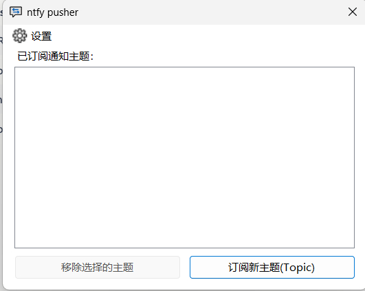
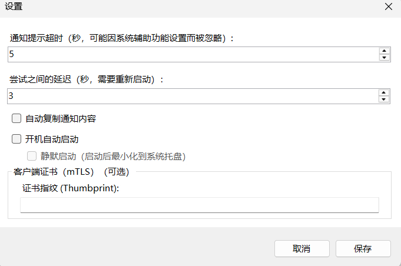

# ntfy pusher Windows

构建命令

dotnet publish ntfysh_client\ntfysh_client.csproj -c Release -r win-x64 --self-contained false -p:Version=1.0.0 -p:DebugType=none -p:DebugSymbols=false -o publish\ntfy

运行要求：目标机需安装 **.NET 8 Desktop Runtime**（框架依赖发布，不含运行时）。

本软件是 ntfy.sh Windows 的一个**增强的中文分支版本**。原版由 Lucas Bortoli 及贡献者开发。
ntfy.sh Windows 是一款轻量级的推送通知客户端，用于接收通过兼容 https://ntfy.sh 标准的服务器发送的通知。

## 核心功能 (原版功能)  
•	**轻量级**： 占用资源少。  
•	**多服务器支持**： 可同时接收来自多个不同 ntfy.sh 兼容服务器（包括但不限于官方 ntfy.sh）的通知。  
•	双协议支持： 通过 Websocket 或 HTTP 两种协议实时接收通知。  
•	**话题支持**： 支持订阅公开（无认证）和私有（认证）话题。  
•	**桌面通知**： 在 Windows 系统托盘中运行，收到消息时弹出桌面通知。   
## 新增与增强内容 (由本分支版提供)  
•	**中文支持**： 软件界面、设置选项均为中文。  
•	**增加开机自启动功能**： 使得信息接收更加便捷  
•	**访问令牌登录**： 不用输入账号密码  
•	**记忆上次订阅服务器**： 直接输入新主题即可订阅  
•	**mTLS 客户端证书支持**： 当 ntfy 服务器开启双向 TLS (mTLS) 时，可在「设置」中填写客户端证书指纹 (Thumbprint)，客户端会从 Windows 系统证书存储（个人 / My，先查当前用户再查本地计算机）读取对应证书用于在 TLS 握手中发送；留空则与普通服务器一样正常连接，不影响使用。  

## 软件截屏
### 主程序

### 通知示例

### 如何发布新版本（维护者）
版本发布由 GitHub Actions 工作流 `.github/workflows/release.yml` 完成，该工作流**不会**随 push/tag 自动触发，需手动运行：

1. 打开仓库页面 → 顶部 **Actions** → 左侧 **Build and Release** → 右侧 **Run workflow**；
2. 分支选择 `master`，点击 **Run workflow** 即可；
3. 工作流会编译 `win-x64`（框架依赖，需目标机已安装 **.NET 8 Desktop Runtime**），打包为 `ntfy-pusher-windows-x64.zip`，并以当前北京时间的日期时间戳 `yyyyMMdd-HHmmss` 作为 tag 与 Release 名称自动创建 Release（含自动生成的发布说明）。

> 注意：本客户端**没有任何更新检查或自动更新功能**。发布后请自行到仓库的 Releases 页下载最新压缩包分发给用户。
